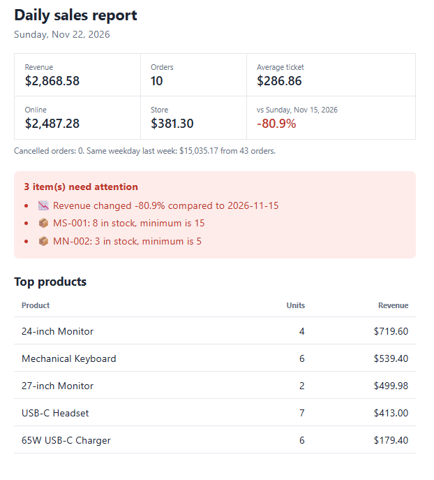
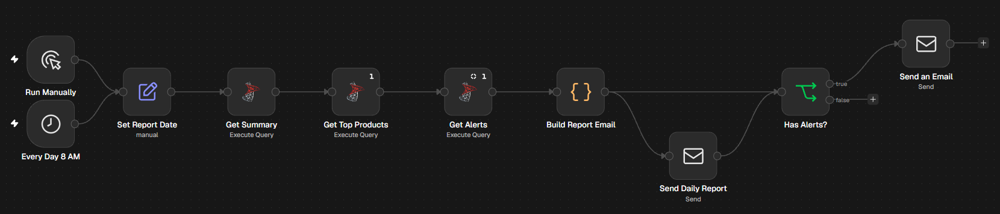
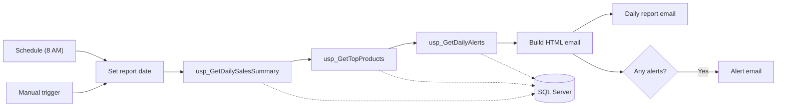

# n8n + SQL Server Daily Sales Report

Every morning, an n8n workflow queries a store's SQL Server database and emails the team a ready-to-read sales report: revenue, orders, average ticket, sales by channel, top products and a comparison with the same weekday of the previous week. When something looks wrong, such as a sharp drop in revenue or a product below its minimum stock, a separate alert email goes out.

It replaces the routine of someone opening the system every day, exporting data to a spreadsheet and building the same report by hand.

## Demo

▶️ **[Watch the demo on YouTube](https://youtu.be/F-N0HIanZDg)**

<a href="https://youtu.be/F-N0HIanZDg">
  
</a>



## How it works

1. A schedule trigger starts the workflow every day at 8 AM (a manual trigger is available for testing).
2. n8n calculates the report date once (yesterday, in the store's time zone) and passes it to every query.
3. Three stored procedures return the daily summary, the top products and any alerts.
4. A Code node combines the results into an HTML email.
5. The report is sent to the team. If there are alerts, a separate alert email is sent as well.





## Tech stack

| Layer | Technology |
|---|---|
| Workflow automation | n8n (Schedule Trigger, Microsoft SQL, Code, If, Send Email) |
| Database | SQL Server 2022 (Developer edition, in Docker) |
| Report logic | T-SQL stored procedures and an inline table-valued function |
| Local email | Mailpit |
| Infrastructure | Docker Compose |

## Project structure

```
.
├── database/
│   ├── 01-schema.sql         Tables and indexes
│   ├── 02-seed.sql           60 days of sample sales, relative to today
│   ├── 03-reporting.sql      Reporting function and stored procedures
│   └── 04-n8n-access.sql     Least-privilege login for n8n
├── docs/images/              Screenshots used in this README
├── n8n/workflows/            Exported n8n workflow
├── .env.example              Template for the SQL Server sa password
└── docker-compose.yml        SQL Server, n8n and Mailpit
```

## Database objects

| Object | Returns |
|---|---|
| `fn_DailySalesSummary(@ReportDate)` | KPIs for a day and the same weekday of the previous week |
| `usp_GetDailySalesSummary @ReportDate` | One row with revenue, orders, average ticket, cancellations, revenue by channel and percentage change |
| `usp_GetTopProducts @ReportDate, @Top = 5` | Best-selling products of the day by revenue |
| `usp_GetDailyAlerts @ReportDate, @RevenueDropThresholdPercent = -30` | One row per alert (revenue drop, low stock), or no rows when everything is normal |

## Getting started

### Prerequisites

- [Docker Desktop](https://www.docker.com/products/docker-desktop/)
- A SQL Server client such as SSMS

### 1. Configure and start the containers

```powershell
Copy-Item .env.example .env
```

Edit `.env` and set a strong `MSSQL_SA_PASSWORD` (at least 8 characters, mixing upper case, lower case, numbers and symbols). Then:

```powershell
docker compose up -d
```

| Service | Address |
|---|---|
| SQL Server | `localhost,14330` (user `sa`) |
| n8n | http://localhost:5678 |
| Mailpit (local inbox) | http://localhost:8025 |

All ports are bound to `127.0.0.1`, so they are only reachable from your own machine.

### 2. Create the database

Connect to `localhost,14330` with the `sa` login (enable **Trust server certificate**) and run the scripts in order:

1. `database/01-schema.sql`
2. `database/02-seed.sql`
3. `database/03-reporting.sql`
4. `database/04-n8n-access.sql`

The seed generates sales up to yesterday, so you can run it again at any time to refresh the data relative to the current date. It intentionally creates a revenue drop yesterday and two products below minimum stock, so the alerts can be seen right away.

### 3. Import the n8n workflow

1. Open n8n, create the owner account and import `n8n/workflows/daily-sales-report.json`.
2. Create two credentials:
   - **Microsoft SQL**: server `sqlserver`, database `SalesReport`, user `n8n_report`, the password from `04-n8n-access.sql`, port `1433`, with **Ignore SSL Issues** enabled (the container uses a self-signed certificate).
   - **SMTP**: host `mailpit`, port `1025`, SSL/TLS off, any user and password.
3. Assign the Microsoft SQL credential to the three query nodes and the SMTP credential to both email nodes.

### 4. Try it

1. Click **Execute workflow** in n8n.
2. Open Mailpit at http://localhost:8025. You should see the daily report and the alert email.
3. Publish the workflow to have it run automatically every day at 8 AM.

## Design decisions

- **The report logic lives in the database.** n8n only calls stored procedures with a date. Changing a KPI means changing one procedure, not editing every workflow that uses it.
- **One source of truth for the summary.** `fn_DailySalesSummary` is used both by the summary procedure and by the revenue drop alert, so the alert can never disagree with the numbers in the report.
- **Index-friendly date filters.** Queries filter with `OrderedAt >= @day AND OrderedAt < @nextDay` instead of `CAST(OrderedAt AS DATE) = @day`, so SQL Server can use the `IX_Orders_OrderedAt` index. The index includes `Status` and `Total`, which covers the summary query without reading the table.
- **The report date comes from n8n.** Procedures do not call `GETDATE()`, so any past day can be reported, re-sent or tested.
- **Alert thresholds are parameters.** The revenue drop sensitivity can be changed in the workflow without touching the database.
- **Least privilege for the integration.** n8n connects with its own login that can only execute the three reporting procedures, through a `report_executor` role. It cannot read or change any table directly. Procedures still work thanks to ownership chaining.
- **Comparison with the same weekday.** Revenue is compared with the same weekday of the previous week instead of the day before, so a Monday is never compared with a Sunday.
- **Two emails instead of one.** The daily report is informational and always sent. Alerts go in a separate message so they stand out and can be routed to different people later.
- **Inline CSS in emails.** Most email clients ignore `<style>` blocks, so every style is inline.

## Going to production

This repository is a local demo. A production setup would also need a trusted TLS certificate on SQL Server with certificate validation enabled, a real SMTP provider, strong passwords managed as secrets instead of the defaults in the scripts, an n8n error workflow to notify someone when the report fails, and handling for holidays in the weekday comparison.

## Author

**Ariel Morais**: .NET developer focused on business process automation.

[LinkedIn](https://www.linkedin.com/in/ariel-morais) · [GitHub](https://github.com/arielm11)
